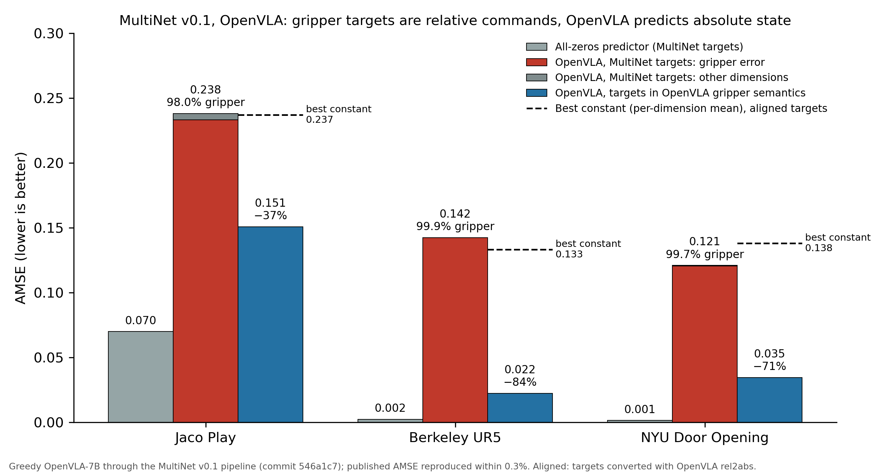

# Gripper-semantics audit of MultiNet v0.1 (OpenVLA)

On 3 of the 20 Open-X datasets in MultiNet v0.1 (Jaco Play, Berkeley UR5, NYU Door Opening),
OpenVLA's **absolute** gripper output (open / closed) is scored against **relative** gripper targets
(change of closedness, 0 = no change). This repository reproduces the published OpenVLA AMSE on
those datasets, shows that the gripper dimension accounts for 98.0-99.9% of it, and quantifies two
ways of aligning the semantics.

All references are to MultiNet commit
[`546a1c7`](https://github.com/ManifoldRG/MultiNet/tree/546a1c77f9a4cc0544c5e4b41565949778d32441).
Every number below is recomputed on a CPU in seconds from the predictions archived here; no GPU,
model weights or dataset downloads are needed. A two-page summary is in
[report/multinet_gripper_audit.pdf](report/multinet_gripper_audit.pdf) (rebuild with `report/build.sh`).



## Finding

For Jaco Play, Berkeley UR5 and NYU Door Opening, the target gripper value is a change command
(+1 close, -1 open, 0 no change; continuous change for NYU Door). Among MultiNet's 20 datasets,
these are exactly the three whose OpenVLA data transform applies `rel2abs_gripper_actions`. OpenVLA
outputs the absolute gripper state (it was trained that way on Jaco Play and Berkeley UR5; NYU Door
is outside its training mixture), which MultiNet's `convert_action` maps to +1 closed / -1 open.
The model therefore cannot express the "no change" class that makes up 75.7-98.5% of the targets.

| | Jaco Play | Berkeley UR5 | NYU Door Opening |
| --- | ---: | ---: | ---: |
| Test steps | 7,838 | 10,156 | 2,209 |
| Published OpenVLA AMSE | 0.2386 | 0.1424 | 0.1209 |
| Reproduced AMSE (MultiNet pipeline, greedy) | 0.2380 (-0.28%) | 0.1424 (+0.001%) | 0.1209 (-0.03%) |
| Gripper share of AMSE | 98.0% | 99.9% | 99.7% |
| All-zeros predictor (MultiNet targets) | 0.0699 | 0.0023 | 0.0013 |
| Fix 1: targets converted to states (`rel2abs`) | 0.1508 (-37%) | 0.0222 (-84%) | 0.0345 (-71%) |
| MSE-optimal constant on fix-1 targets | 0.2370 | 0.1332 | 0.1381 |
| Fix 2: model states converted to commands | 0.0709 (-70%) | 0.0190 (-87%) | n/a (no robot state) |

Fix 1 converts each episode's gripper targets with OpenVLA's `rel2abs` rule. Fix 2 keeps MultiNet's
targets and converts the predicted state into a command against the observed gripper state (UR5
`gripper_is_closed`; Jaco finger joint, binarized at the midpoint of its range).

The other 17 datasets do not show this mismatch: 13 use absolute gripper semantics on both sides,
3 have no gripper dimension, and `ucsd_pick_and_place` compares torque with state (already noted in
MultiNet's code). The full 20-dataset table with code line references, per-axis pose analysis and a
second, independent finding on duplicated `is_last` markers is in
[docs/MULTINET_AUDIT.md](docs/MULTINET_AUDIT.md).

## Limitations

* Only OpenVLA is re-scored; per-step GPT-4o and JAT predictions are not public.
* Three datasets were re-run with the model. For the other 17, two were checked on target
  statistics and the rest from code and dataset descriptions only (see the status column).
* Fix 2 on Jaco depends on the binarization threshold of a finger joint (0.090 / 0.071 / 0.102 for
  thresholds 0.5 / 0.75 / 1.0). NYU Door has no proprioceptive state, so only fix 1 applies there.
* OpenVLA does not beat the all-zeros predictor on every pose axis (UR5 roll; NYU Door overall).
  Pose contributes 0.05-2.0% of the AMSE.

## Reproduce

```sh
python -m pip install -r requirements-audit.txt
python -m unittest discover -s tests
python scripts/verify_artifacts.py && python scripts/verify_baseline_results.py
python experiments/offline/gripper_semantics.py          # every number in the table above
```

GPU re-run of the MultiNet pipeline on any dataset (about 16 GB GPU memory, pinned environment in
[environment/](environment/)):

```sh
python experiments/offline/multinet_targets.py berkeley_autolab_ur5 --scratch SCRATCH --out runs/targets --expected-steps 10156
python experiments/offline/multinet_openvla_baseline.py berkeley_autolab_ur5 --expected-steps 10156 \
    --scratch SCRATCH --out runs/baseline --hf-home HF_CACHE
```

## Repository layout

| Path | Contents |
| --- | --- |
| `experiments/offline/` | Re-scoring with aligned semantics, target statistics, MultiNet re-runs, figure |
| `kaggle/` | Kaggle bundle of the Jaco Play baseline |
| `artifacts/` | Archived per-step predictions, manifests and target statistics ([map](artifacts/README.md)) |
| `docs/` | Full audit and baseline report |
| `scripts/` | Archive and result verification |
| `environment/` | Pinned package list and upstream revisions |
| `tests/` | Unit tests |

## References

```bibtex
@article{guruprasad2024benchmarking,
  title   = {Benchmarking Vision, Language, \& Action Models on Robotic Learning Tasks},
  author  = {Guruprasad, Pranav and Sikka, Harshvardhan and Song, Jaewoo and Wang, Yangyue and Liang, Paul Pu},
  journal = {arXiv preprint arXiv:2411.05821},
  year    = {2024}
}
@article{kim2024openvla,
  title   = {OpenVLA: An Open-Source Vision-Language-Action Model},
  author  = {Kim, Moo Jin and Pertsch, Karl and Karamcheti, Siddharth and Xiao, Ted and Balakrishna, Ashwin and Nair, Suraj and Rafailov, Rafael and Foster, Ethan and Lam, Grace and Sanketi, Pannag and Vuong, Quan and Kollar, Thomas and Burchfiel, Benjamin and Tedrake, Russ and Sadigh, Dorsa and Levine, Sergey and Liang, Percy and Finn, Chelsea},
  journal = {arXiv preprint arXiv:2406.09246},
  year    = {2024}
}
@article{oxe2023,
  title   = {Open X-Embodiment: Robotic Learning Datasets and RT-X Models},
  author  = {{Open X-Embodiment Collaboration}},
  journal = {arXiv preprint arXiv:2310.08864},
  year    = {2023}
}
```
